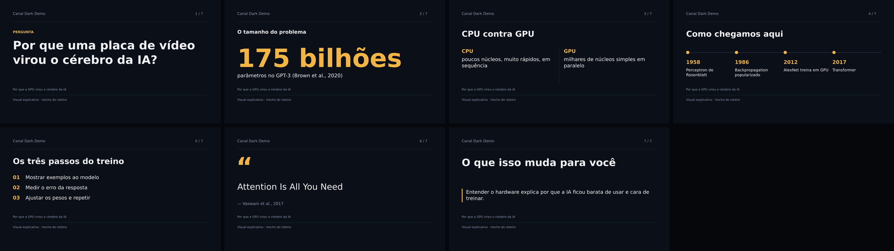
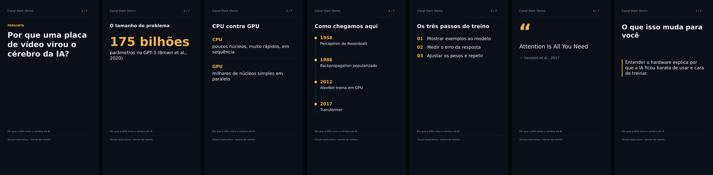

# Guia visual e formatos de vídeo

Este guia define como fica o visual dos vídeos gerados e como o roteiro se
adapta ao formato escolhido. A direção é a de canais dark de tecnologia e
ciência: fundo escuro, uma ideia por tela, tipografia grande e um único
acento de cor.

## A ideia do A2UI, sem o protocolo

Do A2UI vem só o princípio: **o roteiro declara dados, o renderizador decide
a aparência**. O modelo escolhe um layout de um catálogo fechado e preenche
campos tipados. Ele não escreve SVG, HTML nem coordenadas, e não consegue
pedir um componente que não existe.

O protocolo completo não entra: não há streaming de UI, árvore de componentes,
catálogo negociado nem cliente interativo. O vídeo é renderizado uma vez, e
uma diretiva de uma linha resolve o problema.

```text
roteiro (visualBrief) ──► diretiva #layout ──► parser Rust ──► SVG ──► PNG ──► FFmpeg
                              │
                              └─► mesmo parser em TS: rejeita no salvar e na geração
```

- Parser oficial: `crates/framechester-adapters/src/scene_layout.rs`
- Espelho no Studio: `web/shared/scene-layouts.ts`
- Casos compartilhados pelos dois testes: `tests/fixtures/scene-layouts.json`

## Diretivas

A primeira linha do campo **O que aparece na tela?** (`visualBrief`) pode ter
uma diretiva. O restante do campo continua sendo nota livre para o operador.

| Diretiva | Uso | Regras |
|---|---|---|
| *(nenhuma)* ou `#destaque` | título da cena + trecho da narração | comportamento anterior |
| `#pergunta TEXTO` | gancho, loop aberto | 1 campo |
| `#numero VALOR \| LEGENDA` | um dado de escala | VALOR tem dígito e até 16 caracteres, e **precisa ser dito na narração da cena** |
| `#lista A; B; C` | passos ou itens | 2 a 5 itens |
| `#comparacao RÓTULO: texto \| RÓTULO: texto` | dois lados | dois `rótulo: texto` |
| `#linha-do-tempo MARCO: texto; …` | evolução histórica | 2 a 5 marcos |
| `#citacao FRASE \| ATRIBUIÇÃO` | frase documentada | FRASE **precisa ser dita na narração** |

Cada campo aceita até 160 caracteres (rótulos, até 40). Uma diretiva
desconhecida ou mal formada (`#grafico`, `#Lista`, `#lista só um`) gera
erro com o número da cena. Isso acontece ao salvar o roteiro, na resposta da
IA e no render. Nenhum caso cai num layout padrão sem aviso. `# Título` com
espaço é tratado como nota em Markdown.

Por que números e citações precisam estar na narração: assim, o que aparece
na tela também passa pela revisão de alegações do roteiro. Sem essa regra,
um número poderia aparecer só na imagem, sem fonte.

Exemplo completo: `examples/guia-visual-plan.json`.

```bash
cargo run -p framechester-cli -- visuals --input examples/guia-visual-plan.json --output artifacts/guia-visual
```

## Identidade

| Token | Valor | Uso |
|---|---|---|
| Fundo | `#0B0F17` | todas as telas |
| Tinta | `#EEF2F8` | títulos e texto |
| Secundário | `#8C99AE` | canal, contador, rodapé, atribuição |
| Régua | `#243041` | divisores e trilhos |
| Acento | `#F2B544` | só no foco da tela: número, rótulo, marcador, aspas |

- Fonte: Segoe UI → DejaVu Sans → Arial, a primeira instalada. Título em bold, o resto em regular.
- Longo 1920×1080: margem de 112 px, título de 88 px, texto de 44 px.
- Short 1080×1920: margem de 82 px, título de 72 px, texto de 48 px.
- A faixa inferior (290 px no longo, 470 px no Short) fica livre para as
  legendas queimadas.
- Um número nunca é cortado: a fonte diminui até caber em uma linha. Trocar
  "175 bilhões" por "175…" mudaria o sentido.

Longo:



Short:



## Formatos de roteiro

No assistente de criação e em **Produzir com IA**, o campo **Formato do vídeo**
injeta no prompt a estrutura, o ritmo e os layouts preferidos do formato
escolhido. Esse campo vale para Ollama, Claude e OpenAI, porque entra no
prompt do sistema e não depende do provedor. O catálogo fica em
`web/shared/video-styles.ts`.

| Formato | Estrutura | Layouts |
|---|---|---|
| Explicador direto | pergunta → resposta curta → mecanismo em 3 passos → exemplo → consequência | pergunta, lista, comparacao |
| Mistério documental | abertura fria → contexto → pistas encadeadas → explicação popular falha → virada documentada | pergunta, linha-do-tempo, citacao, numero |
| Ranking | critério → itens do menor para o maior → primeiro lugar por último | lista, numero |
| Linha do tempo | gancho no presente → origem → marcos → virada → pergunta em aberto | linha-do-tempo, citacao |
| Comparativo | decisão real → critérios → um critério por cena → veredito por perfil | comparacao, numero, lista |

Regras por duração, somadas ao formato:

- **Short:** a 1ª cena dura até 3 s e já mostra a pergunta ou o fato. Uma ideia por vídeo, frases curtas, e a última fala retoma o gancho.
- **Longo:** a promessa aparece nos primeiros 30 s, um dado ou virada novo a cada 60–90 s, e há uma recapitulação antes da conclusão.

**Limite honesto:** esses formatos reúnem convenções recorrentes do gênero
faceless de tecnologia e ciência. Ninguém mediu o desempenho deles neste
projeto, e eles não foram treinados em dados de canais. Antes de tratar um
formato como vencedor, compare a retenção por formato no analytics do
próprio canal (skills `youtube-channel-analysis` e `marketing-experiments`).
Para um teste interpretável, mantenha o assunto e a duração e mude só o
formato.

## Precisa de um LLM próprio?

Não. Para este problema, seria usar um canhão para matar um mosquito.

| Opção | Custo | Quando faz sentido |
|---|---|---|
| **Formato no prompt + catálogo fechado** (atual) | zero | agora: resolve estrutura, ritmo e visual com Ollama, Claude ou OpenAI |
| Exemplos do próprio canal (few-shot) | zero, ~2–4 mil tokens por chamada | quando houver 3 a 5 roteiros **revisados** com boa retenção |
| LoRA em modelo aberto de 7–8B, servido como GGUF no Ollama | 1 GPU de 16–24 GB por algumas horas, ou aluguel pontual | só com centenas de roteiros revisados e se o few-shot estiver caro ou inconsistente no modelo local |
| Treinar um modelo do zero | ordem de milhões de dólares em computação e dados | nunca, para este caso |

A voz do canal é estilo, e estilo se ensina com exemplos. O conhecimento
factual vem das fontes da pauta, e nenhum ajuste fino substitui a checagem.
Um LoRA aprende o tom, mas também pode aprender a inventar com mais
confiança, então os gates de alegações e o QA continuam valendo do mesmo
jeito.
